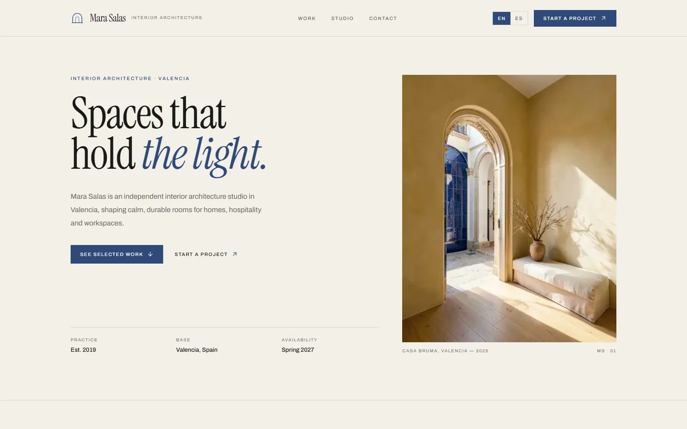

# Mara Salas

A bilingual portfolio for an independent interior architecture studio in Valencia, built as an original front-end with self-hosted imagery.



## What it is

A one-page portfolio for a fictional interior architect: a hero, four selected projects with detail dialogs, the studio and its services, a four-step process, client quotes, short notes and a contact section. The whole page is available in English and Spanish.

It is a presentation site, not a business application. There is no CMS, database or contact backend: enquiries open the visitor's email client, and the copy button writes the address to the clipboard.

## Why this over a portfolio template

- **Clean-room build.** Layout, copy, palette and imagery were written for this project; no template classes, stock photos, copy or names were carried over.
- **A non-software subject.** The portfolio belongs to an interior architecture studio, with project facts, materials and process rather than a developer résumé.
- **Projects that actually open.** Each card opens a native `<dialog>` with the full story, project facts, a second photograph and a link to the enquiry email, plus next-project navigation. Nothing on the page links nowhere.
- **Self-hosted imagery.** Ten WebP photographs were generated for this project and live in `public/images`; the site makes no requests to Unsplash or any other image host.
- **Bilingual by default.** `/[locale]` routes, typed dictionaries, automatic browser-language detection, a manual switcher and `hreflang` alternates.
- **Static by default.** Both locales are prerendered. JavaScript is limited to the mobile menu, the project dialog, the copy button and the locale switcher.
- **Small dependency surface.** Next.js, React, Tailwind CSS and lucide icons. No UI kit, no animation library, no CMS client.

## Quick start

Requirements: Node.js 24 (see `.nvmrc`) and pnpm 11.

```bash
git clone https://github.com/JORDANROBERTO74/mara-salas.git
cd mara-salas
pnpm install
pnpm dev
```

Open <http://localhost:3000>. The proxy redirects to `/en` or `/es` based on your browser's `Accept-Language` and remembers an explicit choice in a cookie.

| Command | What it does |
| --- | --- |
| `pnpm dev` | Start the development server on port 3000 |
| `pnpm build` | Create an optimized production build |
| `pnpm start` | Serve the production build |
| `pnpm lint` | Run ESLint |
| `pnpm typecheck` | Run `tsc --noEmit` |

## Content model

Projects are typed data, not hard-coded markup. The English dictionary defines `Project` in `src/i18n/dictionaries/en.ts`: slug, title, category, location, year, summary, three description paragraphs, four project facts, a cover image and a detail image. The Spanish dictionary implements the same type, so a missing field fails `pnpm typecheck` instead of rendering an empty section.

To add a project, add its images to `public/images`, append an entry to both dictionaries and add a card position in `src/components/work.tsx`. The dialog, the facts table and the next-project link follow automatically.

## Internationalization

- `src/i18n/config.ts` lists the supported locales and the default (`en`).
- `src/proxy.ts` detects the locale and redirects `/` to `/{locale}`.
- Copy lives in `src/i18n/dictionaries/en.ts` and `es.ts`; the English file defines the `Dictionary` type.
- Project years, locations and descriptions are localized; image paths are shared.
- Note dates are stored as ISO strings and formatted with `Intl.DateTimeFormat` in `src/lib/format.ts`.
- Every page declares canonical and `hreflang` alternates from `src/lib/seo.ts`.

## Imagery

`public/images/*.webp` are AI-generated photographs produced with `flux-2-klein-4b` through the local `image-forge` tool. The set uses one palette throughout: lime plaster, pale oak, travertine, linen and cobalt-glazed tile.

- Hero: 4:5, 1024 × 1280.
- Projects: 4:3, 1200 × 900, each with a cover and a detail.
- Studio: 1:1, 1024 × 1024.
- All files are WebP at quality 82, between 32 KB and 191 KB.

No stock photography, third-party logos or remote media remain in the project. The only bitmap outside `public/images` is the screenshot of this build.

## Design

- **Palette.** Bone `#f4f0e8`, ink `#1b1a18` and cobalt `#2f4a7a`, with sand and hairlines. Tokens live in `src/app/globals.css`.
- **Type.** Instrument Serif for display and the wordmark; Archivo for the interface. Both are self-hosted at build time through `next/font`.
- **Light only.** The interface declares `color-scheme: light` and has no dark variant, by design.
- **Form.** Sharp edges, thin rules and an asymmetric project grid; no rounded cards or drop shadows except the dialog.
- **Brand.** The arch mark is drawn in `src/components/brand-mark.tsx`, reused in the favicon and the Open Graph image.

## Accessibility and responsiveness

The project dialog is a native `<dialog>`: it traps focus, closes with Escape or a backdrop click and locks background scrolling. The mobile menu traps focus, closes with Escape and restores focus to its trigger. Notes use native `<details>`, the copy button announces its state with `aria-live`, every icon-only control has an accessible name, and all photography has descriptive alt text. Motion is reduced when the visitor asks for it. Layouts were checked at 1440 px and 390 px.

## Project structure

```text
src/
  app/[locale]/          locale layout, page, not-found, Open Graph image
  components/            header, hero, work and dialog, studio, process, notes, contact, footer
  components/layout/     locale switcher
  config/                site identity, canonical URL and EUR market setting
  i18n/                  locale config, dictionaries and loader
  lib/                   formatting, SEO helpers and class-name utility
  assets/                font instances and licenses for the Open Graph image
public/images/           ten self-hosted project photographs
docs/screenshot.webp
```

## Deployment

The app uses the default Vercel Next.js preset; no `vercel.json` is required.

1. Import the repository and keep the detected settings (`pnpm install`, `pnpm build`, output `.next`).
2. Set `NEXT_PUBLIC_SITE_URL` to the production origin.
3. Deploy, then verify `/{en,es}`, `/sitemap.xml`, `/robots.txt`, both Open Graph images, a project dialog, the mobile menu, the copy button and the 404 route.

`NEXT_PUBLIC_SITE_URL` drives canonical links, `hreflang`, `sitemap.xml`, `robots.txt`, JSON-LD and Open Graph URLs. When it is unset, the code falls back to `https://mara-salas.vercel.app`; the public demo sets it to its Vercel origin.

Live demo: <https://mara-salas.vercel.app>

## Status and scope

This is a portfolio reference implementation. The studio, its people, projects, quotes and photographs are fictional and were created for this repository; the content is sample material, not a real practice. There is no CMS, analytics beyond Vercel Analytics in production, contact backend or e-commerce. Verification covers `pnpm lint`, `pnpm typecheck`, `pnpm build` and a browser pass in both locales at desktop and mobile widths, including the project dialog, next-project navigation, notes, clipboard copy, mobile focus trap and 404 route.

## License

Proprietary, all rights reserved. See [LICENSE](LICENSE). Third-party dependencies and the bundled font instances remain under their own licenses; see `src/assets/OFL-*.txt`.
